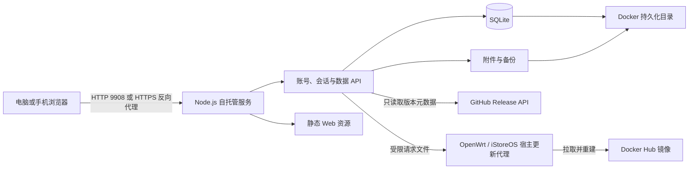

# 架构说明

## 系统结构



| 层 | 实现 |
|---|---|
| 前端 | Vite、统一 TypeScript 启动入口、渐进迁移中的 Vue 3 / TypeScript / Pinia、Tiptap 3、ProseMirror、DOMPurify、fflate；`src/api/` 按领域封装同源请求和响应契约 |
| 服务端 | Node.js 24 HTTP 服务（容器内固定监听 9908）；`server/config.mjs` 在启动前集中解析配置并校验可信代理名单，API 入口统一执行来源与会话校验；认证、账号、附件、备份和知识库用例由应用服务编排，Repository 承担 SQLite 读写 |
| 共享领域 | `shared/` 保存浏览器与服务端共用的知识库、书签校验规则和 API 请求/响应契约；HTTP 错误映射留在服务端边界 |
| 数据库 | Node 内置 SQLite，WAL 模式、同步事务和顺序迁移 |
| 镜像 | `luckyalanzhou/qidian`，支持 `linux/amd64` 与 `linux/arm64` |
| iStoreOS 24.10 / 25.12 与兼容的 OpenWrt | `.run` 自解压安装器部署 LuCI、Compose、管理脚本和受限更新代理，不调用系统包管理器 |

正式入口是 `index.html`。前端代码位于 `src/`，服务端位于 `server/`，数据库迁移位于 `migrations/`。`private_wiki_prototype.html` 只作为原始设计基线，不参与构建。

## 架构演进状态

当前采用单体部署、模块化代码边界。前后端共享一个镜像和同源 API，避免引入独立服务后增加部署和维护负担。迁移按功能逐块进行，旧界面与 API 路径在对应模块完成替换前继续工作。

## 重构阶段与验收

为使进度和验收结果可核对，本次重构按以下四个交付阶段跟踪；阶段以验收结果为准，不按耗时划分。

| 阶段 | 范围与完成标准 | 当前状态 |
|---|---|---|
| 1. 后端模块化 | 配置、HTTP 边界、应用服务、Repository 和共享 API 契约分层；验证鉴权、SQLite 事务、升级兼容与自托管 API。 | 已完成：模块边界和 9908 固定端口已验证；全量测试覆盖 SQLite 与自托管 API。 |
| 2. 前端架构基础 | 建立唯一 Vue/TypeScript 入口、Pinia 状态所有权和按功能组织的页面与动作模块；保持既有功能与交互。 | 已完成：唯一入口、Vue 工作区、Pinia 和主要页面已建立；桌面本地浏览器 smoke test 通过。 |
| 3. 前端迁移收尾 | 将剩余页面副作用、DOM 事件、数据适配和导航编排迁入明确的功能边界；移除生产路径中的旧 DOM 兼容实现及重复状态。 | 已完成：编辑器格式、段落与表格命令已统一委托给功能控制器；Vue 编辑器工具栏按钮直接绑定类型化命令，不再扫描 `data-*` 属性翻译动作；旧工具栏路由只在兼容路径创建；表单读取和正文清理已迁入 `features/editor/form-adapter.ts`；会话过期恢复已迁入 `features/auth/session-recovery-flow.ts`；远端 Vault 更新及活动编辑器保护已迁入 `features/sync/remote-vault-update-controller.ts`，组合层只注入 Pinia、编辑器和导航能力，并由状态分支测试与工作区集成测试覆盖；笔记类型弹窗的配置推导与 Vue/兼容 DOM 分流已迁入 `features/notes/type-dialog-presenter.ts`，覆盖创建限制、编辑数据、删除计数和最后类型转移选项；Vue 面包屑标题直接从页面状态派生，不再镜像写入 Shell Pinia；笔记类型与快速收集的旧 DOM 表单已分别迁入 `features/notes/legacy-type-dialog.ts`、`features/capture/legacy-capture-dialog.ts`，Vue 生产路径不再创建这两个旧表单适配器；生产 Vue 路径也不再创建旧工作区渲染器；生产书签页不再实例化旧 DOM 视图，书签导航、目录偏好、选择清理与新建链接由 Pinia/Vue 路径接管；手机底栏“新建”直接发出类型化 Vue 导航命令；侧栏品牌/新建、桌面/手机搜索、顶栏主题和账号菜单、备份历史动作已由 Vue 组件直接处理；导航命令仍经统一控制器保留未保存编辑确认，工作区壳层命令已迁入 `features/navigation/workspace-shell-actions.ts`，Vue Store 与兼容 DOM 入口共用动作控制器；生产 Vue 路径不再挂载旧 `workspaceContentEvents`，也不再注册 `workspaceNavigationEvents` 与 `workspaceShellEvents` 的全局点击委派，这些 DOM 适配器仅供兼容路径；设置重新载入、备份导入/恢复和同步冲突恢复共用 `features/vault/workspace-replacement-flow.ts`，统一编辑器清理、Vault 替换、主题/书签偏好同步及导航策略；应用组合层已移除可变 `data` 别名，所有当前知识库读取统一通过 Pinia Vault Store 的 `getVault()` 访问，替换数据时不再同步第二份引用，并新增 UI 回归测试覆盖 Store 快照替换；HTML 紧凑纯文本投影已迁入 `features/content/html-content.ts`，搜索、笔记摘要、快速摘录和同步冲突预览共用同一转换并由 DOM 测试覆盖；笔记卡片展示数据投影已迁入 `features/notes/card-snapshot.ts`；编辑器会话与粘贴模式快照已迁入 `features/editor/session-snapshot.ts`；“/”快捷菜单的光标定位与视口边界处理已迁入 `features/editor/slash-menu-controller.ts`；旧编辑器与快速摘录使用的分类选项标记已迁入 `features/categories/legacy-option-markup.ts`，保留分类去重、当前旧分类回显和 HTML 转义；旧新建菜单模板、打开聚焦与关闭动作已迁入 `features/create-menu/legacy-create-menu.ts`；旧编辑器兼容页的异步加载、并发合并、页面离开保护与失败重试迁入 `features/editor/legacy-page-controller.ts`；编辑器 HTML 插入、清理和编辑后草稿同步迁入 `features/editor/html-inserter.ts`；编辑器新页面准备顺序已迁入 `features/editor/page-preparation.ts`；工作区页面分派器自行保存上次渲染页面；编辑器运行时已移除 `app.js` 中无读取用途的草稿 ID 镜像，由运行时控制器独自持有挂载 ID；系统更新弹窗关闭事件由其控制器直接处理，不依赖生产 Vue 路径已移除的旧全局点击委派；`src/app.js` 仍承担页面组合和部分适配。 |
| 4. 系统验收 | 运行 `pnpm test`、`pnpm check`；分别验收 SQLite/DOM、桌面与手机浏览器、Docker 9908 和反向代理；需要的正式构建走远程流程。 | 部分完成：全量 `pnpm test` 646/646 通过，`pnpm check` 检查 191 个 JavaScript 源文件通过；DOM 与 SQLite 自动化覆盖通过。桌面浏览器固定使用 `http://127.0.0.1:5173/`，Vite 带 `--strictPort`。浏览器覆盖笔记编辑与删除/还原、书签创建/编辑/收藏/分组移动/HTML 导入导出/回收站还原、搜索、快捷操作、主题、设置、备份导入导出及更新弹窗关闭；此前清理后笔记、书签、草稿和回收站均为 0，保留原有“审计分类”。本轮验证从干净首页打开空白编辑器并返回首页，又实际切换“书签 → 回收站 → 首页”；笔记、书签、草稿和回收站计数保持为 0。390 与 320 CSS 像素手机视口均无横向溢出，底部导航、新建菜单、全局搜索和侧栏跳转可用；这不替代手机实机验收。本地 Vite 没有服务端版本 API，因此在线更新检查尚未端到端验证。2026-10-20 复测设备 `192.168.100.1:9908` 和 Lucky 反代 `qidian.alan520.top:19908` 的 `/healthz`、`/readyz` 均正常；版本接口需要登录，尚未确认设备版本。GitHub 当前 Release 为 `v0.0.21`，含 `.run` 与 SHA-256 资产，但其目标提交早于本轮源码修复，需阶段完成后远程发布。手机实机与 Docker 实际更新验收仍待完成；本机未打包。 |

## 分阶段验证与推送

- 每个迁移批次只改一个清晰的功能边界。先补或更新该边界的定向测试，再运行 `pnpm check` 和 `pnpm test`；涉及页面交互时，还要在本地浏览器用空白验收数据走完对应流程。发现失败先修复并重跑，再提交推送。阶段完成以门槛通过为准，不以代码已合并或测试已启动为准。
- 2026-10-20：编辑器工具栏格式、插入、表格、编辑、段落和大纲动作统一由 `features/editor/action-dispatcher.ts` 按类型路由；定向单测覆盖全部动作组、编辑器未就绪保护及异步插入结果。桌面浏览器回归使用固定 `http://127.0.0.1:5173/`，验证加粗、插入表格及增删行；结束后清空临时笔记并确认无草稿残留。
- 2026-10-20：导航命令执行与未保存编辑确认已迁入 `features/navigation/workspace-navigation-actions.ts`；Vue 导航 Store 直接调用该动作控制器，兼容 DOM 事件适配器只解析旧页面选择器。既有导航事务测试覆盖取消确认、命令路由和创建菜单行为。
- 2026-10-20：工作区壳层命令执行已迁入 `features/navigation/workspace-shell-actions.ts`；Vue Store 和兼容 DOM 适配器共用同一动作控制器，DOM 事件模块只解析旧页面选择器、处理兼容弹窗关闭；定向测试 138/138、`pnpm check` 和全量 `pnpm test` 617/617 通过。桌面浏览器固定使用 `http://127.0.0.1:5173/`，验证主题菜单及深浅主题动作，并恢复原浅色设置；本次没有新增笔记、书签或回收站数据。
- 2026-10-20：Vue 已挂载时不再创建旧 `workspace-navigation-events.ts` DOM 导航适配器，兼容路径仍通过同一模式工厂创建；增加回归测试覆盖两种模式。
- 2026-10-20：设置重新载入、备份导入/恢复和同步冲突恢复统一通过 `features/vault/workspace-replacement-flow.ts` 清理编辑状态、替换 Vault、同步主题和书签偏好，并显式选择回首页或保留列表上下文。定向测试 19/19、`pnpm check` 检查 182 个 JavaScript 源文件、全量 `pnpm test` 619/619 通过；固定 `http://127.0.0.1:5173/` 浏览器验收设置与自动备份空状态，关闭后笔记、书签和回收站仍为 0；隔离数据库与配置已清理。
- 2026-10-20：生产工作区路径由构建时的 `import.meta.env.PROD` 明确选用 Vue 实现，增加回归测试确保生产模式不依赖挂载标志才启用 Vue 页面；定向测试 138/138、`pnpm check` 和全量 `pnpm test` 620/620 通过。桌面固定端口 `http://127.0.0.1:5173/` 页面显示空白本地空间，未创建验收笔记；本机未打包，最终生产产物仍需远程发布流程验证。
- 2026-10-20：搜索、笔记摘要、快速摘录和同步冲突预览共用 `htmlToCompactText()`，从 `src/app.js` 移除重复 DOM 文本投影；DOM 定向测试 138/138、`pnpm check` 和全量 `pnpm test` 621/621 通过。复用固定端口 `http://127.0.0.1:5173/` 的空白本地工作区，未创建验收数据；本机未打包。
- 2026-10-20：工作区启动、副作用顺序及卸载清理由 `features/lifecycle/workspace-session.ts` 管理；本地预览跳过远端更新检查，已认证恢复草稿仅在无冲突时排队，启动失败也会清理已挂载资源。生命周期与 UI 定向测试 141/141、`pnpm check` 和全量 `pnpm test` 626/626 通过；固定端口 `http://127.0.0.1:5173/` 正常显示空白工作区，未新增验收数据，本机未打包。
- 2026-10-20：固定 `http://127.0.0.1:5173/` 验收笔记、编辑器、书签/分组、搜索、快捷操作、主题、设置、备份和回收站操作；确认弹窗均在页面内呈现。发现版本信息弹窗关闭按钮在 Vue 工作区失效，现由 `features/system-updates/controller.ts` 直接处理，并新增 UI 回归断言；`pnpm test` 626/626、`pnpm check` 通过。清理本轮及旧验收条目后，笔记、书签、草稿与回收站均为 0，保留原有“审计分类”。Vite 本地没有版本 API，在线更新操作未在本地端到端验证；手机、Docker 实际更新与正式发布仍待完成。
- 2026-10-20：响应式浏览器验收使用 390 与 320 CSS 像素视口，页面均无横向溢出；手机底部导航、书签入口、新建菜单开关、全局搜索关闭及侧栏到回收站跳转正常，验收数据保持为空，视口已恢复默认。设备直连与 Lucky 反代的 `/healthz`、`/readyz` 均返回正常；GitHub Release 仍为 `v0.0.21`，其目标提交早于当前 `main`，该补丁尚未进入正式发布；未进行手机实机验收。
- 2026-10-20：补测书签收藏筛选、编辑和分组移动、Netscape HTML 导出、重复网址预览/跳过，以及全部移入回收站后还原。验收后通过应用导入仅含原有“审计分类”和默认笔记类型的空白基线，笔记、书签、草稿及回收站均为 0；临时基线与导出文件已删除。
- 2026-10-20：笔记卡片展示字段和默认值由 `features/notes/card-snapshot.ts` 投影，`app.js` 只注入类型名、正文摘要和日期格式化；新增单测 2/2，`pnpm check` 检查 184 个 JavaScript 源文件通过，全量 `pnpm test` 628/628 通过。固定端口桌面页重新载入后首页可用、浏览器控制台无错误、笔记与书签计数均为 0；本机未打包。
- 2026-10-20：编辑器会话快照与粘贴模式校验已迁入 `features/editor/session-snapshot.ts`，应用组合层只提供当前笔记、类型、分类及领域适配器；新增单测 3/3，`pnpm check` 检查 185 个 JavaScript 源文件通过，全量 `pnpm test` 631/631 通过。固定端口浏览器打开空白编辑器并返回笔记列表正常，笔记仍为 0；本机未打包。
- 2026-10-20：斜杠快捷菜单的光标定位和视口边界计算已迁入 `features/editor/slash-menu-controller.ts`，新增单测 3/3；`pnpm check` 检查 186 个 JavaScript 源文件通过，全量 `pnpm test` 634/634 通过。固定端口浏览器在空白编辑器内输入 `/` 后显示插入菜单，Escape 可关闭，退出后笔记计数仍为 0；本机未打包。
- 2026-10-20：旧编辑器与快速摘录的分类选项 HTML 已迁入 `features/categories/legacy-option-markup.ts`；去重、旧分类回显与文本转义定向测试 3/3，`pnpm check` 检查 187 个 JavaScript 源文件通过，全量 `pnpm test` 637/637 通过。该适配仅服务未挂载 Vue 时的兼容入口；本机未打包。
- 2026-10-20：旧新建菜单的懒创建、无障碍选项、首项聚焦与关闭委托已迁入 `features/create-menu/legacy-create-menu.ts`；定向菜单与键盘/遮罩关闭测试 4/4，`pnpm check` 检查 188 个 JavaScript 源文件通过，全量 `pnpm test` 638/638 通过。该控制器仅用于兼容入口；Vue 正式路径仍由组件和 Pinia 管理；本机未打包。
- 2026-10-20：旧编辑器兼容页的异步模块加载已迁入 `features/editor/legacy-page-controller.ts`，覆盖并发去重、加载后页面仍活动才渲染、失败提示和重试；定向测试 3/3、编辑器 DOM 集成回归 24/24、`pnpm check` 检查 189 个 JavaScript 源文件通过，全量 `pnpm test` 641/641 通过。固定端口桌面页显示干净首页，笔记、书签和回收站计数均为 0；本机未打包。
- 2026-10-20：编辑器 HTML 插入、正文清理及插入后草稿同步迁入 `features/editor/html-inserter.ts`；定向编辑器回归 11/11、DOM 编辑器集成 37/37、`pnpm check` 检查 190 个 JavaScript 源文件通过，全量 `pnpm test` 644/644 通过。固定端口浏览器真实插入并清空 2×3 表格；空白瞬时笔记的自定义放弃确认框待用户点击，本机未打包。
- 2026-10-20：当前编辑基线与未落库新笔记标识从 `app.js` 局部变量迁入 `features/editor/store.ts`，与编辑表单和工具栏状态由同一 Pinia Store 持有；定向会话/草稿/持久化测试 17/17、DOM 编辑器集成 45/45，`pnpm check` 检查 190 个 JavaScript 源文件通过，全量 `pnpm test` 644/644 通过。固定端口热更新后回到干净首页，笔记、书签与回收站均为 0；本机未打包。
- 2026-10-20：编辑器新页面准备顺序迁入 `features/editor/page-preparation.ts`，集中处理旧编辑器卸载、草稿恢复、选项读取与会话状态同步；定向测试 2/2、DOM editor regression 43/43、`pnpm check` 检查 191 个 JavaScript 源文件、全量 `pnpm test` 646/646 通过。固定端口浏览器打开空白编辑器并返回首页，笔记、书签、草稿和回收站均为 0；本机未打包。
- 2026-10-20：工作区页面分派器自行持有上次渲染页面状态，移除 `app.js` 中重复的 `lastRenderedPage`；书签离页清理仍在切换到新页面前执行。页面分派与 UI 定向测试 138/138、`pnpm check` 检查 191 个 JavaScript 源文件、全量 `pnpm test` 646/646 通过；固定端口浏览器验证“书签 → 回收站 → 首页”，笔记、书签、草稿和回收站计数均为 0；本机未打包。
- 2026-10-20：编辑器运行时控制器已持有挂载草稿 ID，删除 `app.js` 中只写不读的镜像状态；运行时定向测试 1/1、`pnpm check` 检查 191 个 JavaScript 源文件、全量 `pnpm test` 646/646 通过。固定端口浏览器进入空白编辑页并返回首页，笔记、书签、草稿和回收站均为 0；本机未打包。
- 2026-10-20：Vue/生产工作区不再创建只供旧 DOM 兼容页使用的编辑器懒加载控制器，兼容模式保持原行为；`ui.test.mjs` 133/133、`pnpm check` 检查 191 个 JavaScript 源文件、全量 `pnpm test` 646/646 通过。固定端口浏览器打开空白编辑器并返回首页，笔记、书签、草稿和回收站均为 0；本机未打包。
- 第 3 阶段按“编辑器与页面生命周期 → 导航及工作区编排 → 设置、备份和账户流程 → 笔记列表、书签与回收站剩余适配 → 清除生产路径旧 DOM 和重复状态”的顺序逐块迁移。每个功能边界的测试通过后单独提交并推送 `main`，避免把尚未验证的跨功能重构累积到一个大提交。
- 第 4 阶段按“SQLite/API 与 DOM 回归 → 桌面浏览器完整操作 → 手机实机操作 → iStoreOS/Docker 9908 安装、更新和数据保留 → 反向代理”验收。每轮浏览器验收开始前清理明确标记的旧验收数据，结束后清理本轮数据和站点存储；不确定归属的数据保留并标记为未验证。
- 本地浏览器验收固定使用 `http://127.0.0.1:5173/`，以 `--strictPort` 启动；端口占用时先确认并关闭本任务启动的旧服务，不临时换端口。
- 本机只做源码检查、测试和浏览器验收，不执行打包。代码推送后，只有在用户提出构建时才运行远程发布流程；发布结果需核对镜像、安装包、校验文件和 Release 状态。
- 2026-10-20 编辑器生命周期批次：编辑器页面的异步初始化已迁入 `features/editor/page-lifecycle.ts`；测试覆盖并发初始化合并、离开页面后阻止过期挂载、加载失败后可重试。定向测试 3/3、编辑器 DOM 集成测试 132/132、`pnpm check` 和全量 `pnpm test` 613/613 通过。隔离桌面浏览器验证了编辑器加载、正文回车分段、保存离开及重新进入；本轮验收环境与数据已清理。未进行手机实机验收，未在本机打包。
- 第 3 阶段迁移门槛已完成：Vue/生产工作区由 Vue、Pinia 和功能控制器管理；旧 DOM 视图与事件适配只在兼容路径创建，`app.js` 作为组合根负责依赖装配。页面导航通过 Pinia 导航状态与工作区控制器管理，URL 路由不属于本阶段验收范围。第 4 阶段仍需完成远程发布后的资产核验；手机实机与设备上的 Docker 更新未执行，分别记录为待验证。

- 新交互从 `src/features/` 开始使用 Vue 3、TypeScript 和 Pinia；认证、账号、设置、提示通知、桌面顶栏菜单与面包屑、手机抽屉及底部导航、新建入口、快速操作面板、桌面侧栏、首页、笔记列表、阅读与编辑页面、书签和回收站均按功能拆分。导航 Pinia 保存页面、筛选、当前笔记、编辑草稿和返回上下文；工作区壳层 Pinia 持有主题/账号菜单、移动抽屉状态与兼容页面面包屑投影、已解析主题和临时账号显示信息；Vault Pinia 持有账号知识库，首页、笔记列表、阅读、编辑、书签和回收站的激活状态直接从导航与 Vault 派生，不再由 `app.js` 逐页推送同步标志。首页和笔记列表从 Vault generation 派生视图快照。侧栏计数、类型和分类也由 Vault generation 驱动的 Pinia 视图快照提供。笔记筛选、阅读、删除、书签维护及回收站操作继续调用领域控制器，并通过原有保存队列或 SQLite 事务持久化。全局确认、输入、笔记类型、分类、网页摘录和新建菜单均由 Vue 组件与 Pinia 状态呈现；菜单动作通过类型化导航命令分派，保留离开未保存编辑时的确认。分类创建经过独立领域流程和 Vault 写事务，网页摘录由独立流程校验正文、构造草稿并等待 Vault 写事务成功。同步冲突复核界面由 Vue 弹窗呈现，控制器负责备份对照和用户确认。全局提示由 `app.js` 直接写入通知 Pinia Store，Vue 组件负责显示与自动消失。设备更新、备份恢复、笔记草稿与类型管理、编辑器生命周期和工具栏命令均拆入 `src/features/`。浏览器与服务端共用 `shared/` 领域规则；`src/api/` 按领域封装同源请求和响应校验；`src/features/sync/cloud-sync-engine.ts` 负责串行保存、多设备同步、revision 冲突合并及重试，`src/cloud.js` 组合认证、草稿恢复和备份 API 并提供兼容门面。生产入口要求 Vue 根挂载成功，失败时显示错误并停止；`features/navigation/legacy-workspace-renderer.js` 承载仅供迁移测试使用的旧 DOM 首页、笔记列表、阅读页和侧栏，`features/editor/legacy-editor-view.js` 保存旧编辑页模板。书签、笔记类型、快速收集、旧工作区渲染器和旧编辑工具栏只在非 Vue 兼容路径创建，生产的对应交互由 Vue/Pinia 处理；回收站与编辑器兼容入口仍保留在 `app.js`，生产不会回退到旧页面。Vue 阅读正文与目录只由 Pinia 快照生成。`src/app.js` 仍负责页面事件、数据适配与导航副作用，尚未完成 Vue Router/页面组件化迁移。
- `features/vault/store.ts` 现作为当前账号 Vault 快照的 Pinia 所有者；兼容期仍以原始对象引用承载数据，但业务写入统一经过 `mutate`，完整快照替换经过 `replace`，两者都会递增 generation。笔记草稿保存策略位于独立类型化领域动作，书签与回收站控制器通过组合层注入写入动作；用于校验或事务的临时副本仍可由纯领域函数直接修改。Vue 页面继续通过功能快照适配器读取数据，后续迁移再让页面直接订阅领域状态。
- `features/vault/mutation.ts` 为需要立即持久化的业务动作提供共享事务边界：复制 Vault 候选、运行共享校验、更新 Pinia 所有者、等待服务端提交，并仅在当前候选仍有效时回滚失败写入。笔记移入回收站与回收站还原、清空和过期清理已经使用该边界；其余写入流程按领域逐步迁入。
- `features/notes/selectors.ts` 将草稿识别、已发布版本映射、笔记列表筛选、全文搜索和排序从应用组合层移出；HTML 正文转文本和草稿有效内容判断由调用层注入。Pinia 笔记列表状态结合 Vault generation 和导航查询条件派生卡片快照，Vue 页面直接订阅该状态，不再由应用组合层逐次推送列表副本。`features/dashboard/store.ts` 直接读取 Vault generation 并在功能边界内组合 `snapshot.ts`；`features/dashboard/actions.ts` 负责布局与分组展开偏好的 Vault 写入和持久化，不直接操作 DOM，Vue 页面通过响应式快照更新。
- `features/navigation/sidebar-store.ts` 从 Vault generation 派生笔记、类型、分类、书签和回收站计数；`features/trash/store.ts` 直接订阅 Vault generation 并从现有回收站投影读取条目。两者移除了应用组合层逐次推送的 Vue 同步桥，回收、恢复和清空动作通过 Pinia 显式绑定事务控制器。
- 侧栏兼容视图只在 Vue 实际未挂载时生成；Vue 页面折叠类型只更新 Vault 偏好，由 Pinia 响应式状态驱动属性，不再由应用层直接改写 Vue 管理的 DOM。
- `features/bookmarks/store.ts` 直接订阅 Vault generation，并在 store 内持有目录、搜索、整理与选择状态；`features/bookmarks/snapshot.ts` 从当前 Vault 和界面状态生成书签页投影。页面操作仍由 store 绑定的书签事务控制器执行，持久化继续经过 Vault 保存队列。
- `features/bookmarks/operations.ts` 集中处理收藏切换和同级排序，Vue 与兼容 DOM 入口共用不可变树变更函数，避免两套实现的行为分叉。
  - `features/bookmarks/view-actions.ts` 在 Pinia 边界处理书签搜索、分组选择、整理模式和选择状态；书签编辑、删除、清空、批量移动/删除、HTML 导入/导出及目录偏好由功能事务控制器处理，数据写入经过 Vault 校验与持久化确认。Vue 页面提供一致的编辑、删除、批量操作和导入预览弹窗；旧 DOM 书签控制器只保留未挂载 Vue 时的备用页面入口。
- `features/content/html-content.ts` 集中安全 URL 判定、HTML 白名单清理、Markdown 与纯文本结构转换、笔记正文展示和粘贴标题提取；DOM、DOMPurify 清理器及 Markdown 判定通过依赖注入提供，应用组合层继续负责将结果接入编辑器、阅读器和剪贴板流程。
- `features/content/pasted-title-autofill.ts` 将剪贴板标题填入空的笔记或摘录标题字段，并通过 `input` 事件接入编辑状态；已有标题保持不变。
- `features/categories/category-dialog-controller.ts` 统一 Vue 与兼容页面的分类弹窗打开、关闭、保存成功跳转和失败反馈；分类内容仍通过 Vault 事务控制器写入。
- `features/categories/legacy-category-dialog.ts` 封装兼容页面的分类弹窗重置、聚焦、读取和安全错误呈现；Vue 页面继续使用 Pinia 分类弹窗组件。
- `features/editor/legacy-editor-outline-view.ts` 管理兼容编辑器的标题目录渲染、定位和事件清理；Vue 编辑器继续使用 Pinia 大纲快照。
- `features/navigation/mobile-menu-focus-controller.ts` 统一抽屉关闭后的焦点恢复；只在抽屉已打开且原焦点位于抽屉内，或调用方明确要求时移动焦点。
- `features/notes/type-dialog-open-flow.ts` 统一打开笔记类型弹窗前关闭菜单，并在编辑状态下先保存草稿、清理自动保存、退出编辑和刷新页面。
- `features/capture/capture-dialog-presenter.ts` 统一快速收集弹窗的 Vue/兼容页面配置和关闭入口，按当前知识库提供类型、分类与粘贴模式。
- `features/capture/capture-dialog-controller.ts` 统一快速收集提交后的页面跳转和兼容弹窗的关闭/失败提示；只有 Vault 事务成功后才打开新建的摘录笔记。
- `features/account/sign-out-flow.ts` 在退出账号前保存当前编辑草稿并刷新待写入队列；只有数据写入成功后才注销并重新加载页面。
- `features/settings/backup-history-open-flow.ts` 在打开备份历史前处理活动草稿、关闭遮挡菜单和设置弹窗，并等待快照列表刷新。
- `features/reader/store.ts` 从 Vault generation 和导航状态派生当前阅读页；`snapshot.ts` 统一生成正文标题锚点、目录、阅读时长、来源安全链接、日期和发布操作状态；`reader-actions-store.ts` 提供 Vue 阅读操作的类型化命令边界，`actions.ts` 编排编辑、预览、发布、收藏、副本和删除，收藏与副本经 Vault SQLite 事务提交成功后才报告或打开；`code-copy.ts` 管理正文代码块复制按钮、剪贴板回退和组件卸载清理。Vue 阅读页直接订阅 Pinia 并管理代码块增强生命周期，兼容 DOM 事件复用同一阅读动作控制器。
- Vue 面包屑标题直接从导航、笔记列表、编辑器和阅读器 Store 派生，不再复制到 Shell Pinia；阅读页根据阅读快照设置可访问名称，并在当前笔记已不存在时通过类型化导航命令返回笔记列表。
- `features/editor/autosave-controller.ts` 统一管理编辑器防抖定时器、显式提交和生命周期清理；应用组合层只注入浏览器窗口计时器与草稿保存动作。
- `features/editor/editor-page-actions-store.ts` 定义编辑页保存、附件、HTML 导出、图片选择和删除的类型化动作边界；Vue 页面显式分派动作，旧 DOM 兼容事件复用相同应用处理器。
- `features/editor/page-actions.ts` 编排编辑页操作并确定 HTML 导出版本：编辑中先保存草稿，预览与草稿导出当前版本，普通阅读状态导出已发布快照。
- Vue 编辑器工具栏由 `EditorPage.vue` 静态声明；`features/editor/store.ts` 持有编辑基线、未落库新笔记标识、选区格式、段落、表格、撤销重做和快捷插入菜单等编辑会话状态，运行时更新 Pinia；`features/editor/action-dispatcher.ts` 按类型将工具栏动作路由到对应功能控制器，应用组合层只负责绑定编辑器、插入和大纲依赖；`features/editor/command-controller.ts` 是格式、段落、表格和编辑命令的单一实现；`SlashMenu.vue` 按类型化编辑命令操作 Tiptap。`features/editor/legacy-toolbar-view.ts` 集中管理仅供迁移测试使用的旧 DOM 工具栏状态与布局。
- `features/editor/outline-controller.ts` 从 Tiptap 文档生成标题目录，并通过类型化编辑动作定位标题；目录快照由 Pinia 持有，桌面侧栏与手机目录均由 `EditorPage.vue` 响应式渲染。旧 DOM 回退保留原目录适配器，生产 Vue 页面不再由 `app.js` 注入目录 HTML 或逐项绑定事件。
- `features/notes/draft-content.ts` 管理草稿有效内容判定与编辑基线比较；空白新笔记和未填写的结构化模板不会被当成已写内容，正文文本、图片和有效元数据会保留为草稿。
- `features/notes/create-note-controller.ts` 编排新建笔记的类型与分类选择、活动草稿处理、Vault 写入及编辑页激活；笔记实体规则继续复用 `note-actions.ts`，页面组合层只注入导航和界面副作用。
- `features/notes/html-export-service.ts` 将单篇 HTML 生成、本地附件内嵌和下载封装在笔记功能中；`features/sync/conflict-export-service.ts` 负责打包冲突双方的 Vault 与附件，`cloud.js` 仅注入 API 和下载能力。
- `workspace-shell-actions.ts` 负责主题与账户菜单、类型操作和笔记删除确认等全局工作区命令；Vue Store 与兼容 DOM 入口共用该动作边界。`workspace-shell-events.ts` 仅把旧页面选择器映射为类型化命令，并适配搜索和兼容弹窗关闭。
- `workspace-content-events.ts` 负责笔记编辑、发布、收藏、回收站、备份和移动端菜单入口；页面动作以同步路由为主，只有事务型动作异步等待结果。
- `workspace-static-dom-events.ts` 集中挂载摘录粘贴、类型和分类快捷键及静态弹层关闭事件，并返回卸载函数；页面组合层只注入具体业务回调。`Ctrl+K` / `⌘K` 打开 Vue 快速操作面板，搜索查询与结果由 Pinia 管理；顶栏搜索也直接使用该 Store。
- `features/appearance/theme-controller.ts` 管理系统主题偏好、操作系统主题监听、文档颜色属性与 Pinia 投影；`features/editor/remote-refresh.ts` 将远端 Vault 更新安全同步到活动编辑器，保留编辑基线、表单状态和光标位置。
- `features/sync/remote-vault-update-controller.ts` 负责应用远端 Vault 快照、保留本地编辑、恢复未提交的新草稿，以及在远端删除当前笔记时安全退出编辑并恢复页面滚动位置；应用组合层仅注入 Pinia、编辑器和导航副作用。
- Vue 仪表盘、笔记列表、笔记卡片、桌面侧栏、手机底栏与阅读/编辑返回按钮通过 `navigation-actions-store.ts` 发出类型化导航命令；`workspace-navigation-actions.ts` 负责命令执行与未保存编辑确认，Vue Store 直接绑定此控制器。`workspace-navigation-events.ts` 仅把兼容 DOM 的旧选择器转换为类型化命令，且 Vue 已挂载时不会构造该适配器；侧栏类型和分类操作、笔记卡片删除通过 `workspace-shell-actions-store.ts` 发出类型化功能命令，由 `workspace-shell-actions.ts` 执行并沿用删除事务。
- 服务端 `server/api.js` 负责 Origin 校验、会话认证、公共响应策略和路由分发。账号、认证、设备更新、知识库、备份和附件分别位于 `server/features/`，继续使用现有 Request / Response 接口，供 Node.js HTTP 服务复用。`server/validation.js` 将共享领域校验错误映射为稳定的 HTTP 错误类型。
- `shared/api-contracts.js` 定义 JSON API 请求与响应的运行时校验，`shared/api-contracts.d.ts` 提供同源 TypeScript 类型。前端对认证、密码、知识库写入和设备更新等 JSON 请求在发送前校验；服务端在进入领域处理前校验相同的请求契约。服务端 `server/http-responses.js` 集中安全响应头，并强制成功 JSON 响应声明契约、错误响应符合共享错误结构；前端 `src/api/client.ts` 验证成功响应及错误对象形状，避免仅靠 `as T` 掩盖服务端与前端的字段漂移。头像和附件等二进制响应不经过 JSON 契约。
- `server/features/` 负责 HTTP 参数、限流和 Cookie、状态码及错误映射；首个管理员初始化、注册、登录挑战、凭据验证与会话创建由 `server/application/auth-service.js` 编排；账号资料、头像和密码用例由 `server/application/account-service.js` 编排验证、条件更新和 Repository 调用；附件上传、分块读取与基于当前知识库及历史快照的清理由 `server/application/asset-service.js` 编排；备份列表、创建与快照读取由 `server/application/backup-service.js` 编排；知识库读写用例由 `server/application/vault-service.js` 编排校验与 revision 冲突处理；设备版本检查和更新授权由 `server/application/system-update-service.js` 编排，HTTP 功能层负责读取请求并映射响应。容器密码重置命令通过本机 SQLite 仓储完成账号查询和事务更新。账号私有数据 SQL 始终带账号条件，revision 冲突仍返回原有 409 响应。
- 这一步不改变 SQLite 表结构、数据 JSON、API 地址、9908 端口、`/data` 挂载或反向代理配置。全面切换框架与数据库结构都要另行经过兼容性验证，不能与界面迁移捆绑。
- `src/main.ts` 是唯一前端启动入口，先挂载唯一 Vue 根应用，再加载 `src/application.ts` 处理认证引导和工作区启动，避免多个入口对 DOM 初始化顺序产生隐式依赖。

导航状态转移和常规页面副作用已拆为可独立验证的功能模块。`src/workspace-app.ts` 是唯一 Vue 应用与 Pinia Store 注册点，`mountWorkspaceApp()` 保证应用只挂载一次；`src/main.ts` 先挂载该根应用，再动态加载 `src/application.ts`，由其协调认证引导和工作区启动；`src/app.js` 导出工作区组合函数，不再负责会话引导。云端同步轮询、页面恢复时刷新和过期回收站清理统一由 `features/lifecycle/workspace-lifecycle.ts` 管理，并可卸载其定时器与事件监听。下一阶段继续把 `app.js` 中的页面副作用迁入功能模块，并让 Vue 状态成为单一事实来源；达到页面完全由 Vue 管理后再评估 Vue Router。服务端保持单进程模块化结构；进程启动由 `server/selfhost.mjs` 管理，HTTP 与静态资源适配位于 `server/http-server.mjs`，设备更新文件通信位于 `server/host-updater.mjs`，先稳定领域 API 契约，再评估 TypeScript 与 HTTP 框架。每次迁移以需求文档、DOM、SQLite 和自托管集成测试验证。

## 数据目录

容器内统一使用 `/data`：

```text
/data/
├── qidian.sqlite
├── qidian.sqlite-wal / qidian.sqlite-shm   运行时文件
├── migration-backups/                      结构迁移前的数据库副本
└── .qidian-update-control/                 OpenWrt / iStoreOS 更新请求、状态和日志
```

iStoreOS 将当前设备 Docker Root Dir 下的 `volumes/qidian/data` 挂载到 `/data`。通用 Docker 将 `qidian-data` 命名卷挂载到 `/data`。路径由部署端决定，应用代码不写死宿主目录。

SQLite 启动参数包含外键、5 秒 busy timeout、WAL 和 FULL synchronous。服务启动时按文件名顺序执行尚未应用的迁移；迁移前复制数据库到 `migration-backups`。旧的单人表与早期认证字段保留，是为了兼容已有设备升级，不能作为“未使用文件”删除。

## 账号与会话

客户端使用 PBKDF2-HMAC-SHA-256 派生登录验证值，随机盐和迭代参数由服务端挑战决定。服务端保存派生结果，不保存明文密码。

- 密码派生迭代次数：600,000。
- 会话期限：连续 3 天未使用后失效，登录满 7 天强制重新验证；活动期限最多每小时续期一次。
- Cookie：`qidian_session`、HttpOnly、SameSite=Strict；HTTPS 请求额外设置 Secure。
- 登录、注册和更新操作包含 Origin 检查与请求频率限制。
- 所有账号数据通过 `account_id` 隔离。
- 修改或重置密码时删除该账号的其他会话。

第一次自托管启动且数据库没有账号时，状态接口允许创建首个管理员。管理员创建完成后，注册由 `REGISTRATION_ENABLED` 控制。LuCI 只读取“等待创建管理员/管理员已创建”状态，不读取账号和密码。

## 保存与多设备

前端编辑停止约 250 毫秒后把当前知识库加入串行保存队列。保存请求携带 SQLite revision；服务端只有在 revision 匹配并完成事务后才返回成功。界面不会把“进入队列”显示成保存成功。

前台页面每 2.5 秒读取轻量 revision，重新进入前台时立即检查。revision 改变后才下载完整知识库：

1. 不同笔记、不同字段和不重叠正文修改自动合并。
2. 合并结果先更新当前内存，再以最新 revision 写回。
3. 同一段内容发生重叠修改时停止自动覆盖，保留本机和服务端两个版本。
4. 用户先下载冲突对照 ZIP，再明确选择恢复服务端版本或继续处理本机版本。

生产模式不把正文作为长期副本写入浏览器。网络失败时只保留当前页面内存和必要的一次恢复槽，服务恢复后重试。

## 编辑与内容安全

Tiptap JSON 是粘贴和编辑过程中的统一结构，SQLite 中继续保存经过清理的 HTML。Markdown 通过 `@tiptap/markdown` 转成 JSON，再经过允许节点、属性和 URL 规则清理。兼容纯文本整理器只在用户选择对应模式时使用，避免两套解析器重复插入。

DOMPurify 和服务端校验共同阻止脚本、事件属性、表单、iframe、危险协议和越权附件地址。远程图片使用原 URL，不自动下载；本地图片通过鉴权附件 API 分块写入 SQLite。

当前限制：

- 单附件 8 MiB。
- 每账号附件合计 100 MiB。
- 每账号知识库序列化数据不超过 1,000,000 UTF-8 字节（约 0.95 MiB），计入笔记、书签、回收站和偏好设置；附件单独计限。
- 单篇正文与已发布快照正文长度不超过 1,000,000 个 JavaScript 字符，按 JavaScript 字符串长度校验。
- 书签和分组合计 10,000，层级最多 32。

## 历史与备份

SQLite 触发器在数据更新前保存正文快照，每分钟最多一个，按创建时间保留最近 20 个。完整 ZIP 由前端读取已鉴权的知识库和附件后生成，包含 `vault.json` 与原始附件。完整导入和历史恢复前，客户端先确认待保存内容已完成 SQLite 事务，再下载完整 ZIP 并请求服务端保留当前快照。单篇 HTML 导出会尽可能内嵌本地附件；远程资源仍依赖原站。

附件清理只删除当前知识库和保留快照都未引用的当前账号附件；删除账号、清理其他账号或绕过鉴权均不在该接口能力范围内。

正文快照、ZIP 导出和宿主目录备份用途不同。设备迁移或删除数据卷前，应同时导出 ZIP 并复制整个持久化目录。

## 版本检查与在线更新

已登录用户可读取当前版本和固定仓库的最新稳定 Release；只有首个账号可以提交设备更新。

容器不挂载 Docker Socket。更新流程使用两个受控挂载目录：

- 容器可写请求目录，只能创建固定的 `update-request` 文件。
- 容器只读状态目录，用来读取状态和最近 64 KiB 日志。

OpenWrt / iStoreOS 宿主代理由 procd 管理，处理步骤如下：

1. 从固定 GitHub 仓库读取最新 Release。
2. 下载带版本号的 `.run` 及 `.sha256`。
3. 校验 SHA-256 与版本号。
4. 更新 LuCI 和宿主管理文件。
5. 等待 10 秒，拉取适合当前架构的 Docker Hub 镜像。
6. 使用设备锁重建容器并确认目标版本健康。
7. Web 确认目标版本在线后倒计时 5 秒并刷新页面。

更新状态与日志放在该设备的 Docker 数据目录下。历史成功状态不能代替本次任务结果，Web 必须确认当前目标版本已经运行。

## 网络边界

默认 HTTP 9908 只适合可信局域网。公网访问应使用 HTTPS 反向代理，设置 `TRUST_PROXY=true`，并用 `TRUSTED_PROXY_IPS` 限定直接代理地址。代理必须重写 `X-Forwarded-Proto`、`X-Forwarded-Host` 和 `X-Forwarded-For`，同时阻止公网直接访问容器端口。

版本检查会访问 GitHub，镜像安装和更新会访问 Docker Hub；知识库正文、附件和账号数据不会发送到这些服务。公网访问的 TLS、域名和端口转发由部署环境负责。
